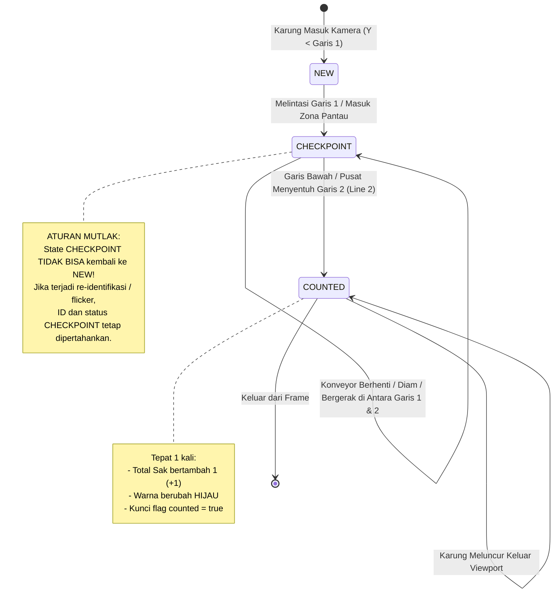
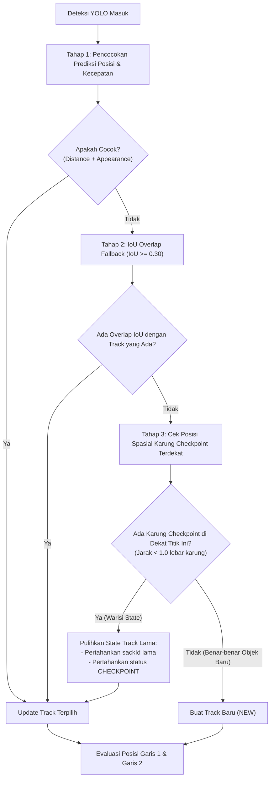

# Rencana Implementasi: Peningkatan Akurasi Counting & State Persistence Anti-Degradasi

Dokumen spesifikasi teknis dan rencana implementasi (*engineering task ticket*) ini dibuat secara komprehensif dan terperinci untuk **Junior Programmer** atau **AI Model (tier standar/hemat)** guna memperbaiki anomali deteksi, mencegah karung yang sudah di-checkpoint kembali menjadi `NEW`, serta meningkatkan akurasi penghitungan sak hingga mendekati 100%.

---

## 1. Analisis Masalah & Akar Penyebab (Root Cause Analysis)

### Masalah 1: Karung yang Sudah di Checkpoint Tiba-tiba Berubah Menjadi "NEW"
- **Akar Masalah di Tracker ([`src/stable_tracker.cpp#L125-L136`](file:///C:/dev/cpp_rtsp/src/stable_tracker.cpp)):**
  1. **Penolakan Pencocokan yang Terlalu Ketat (*Over-aggressive Match Rejection*):**
     Saat karung berputar, berkerut, atau berubah bentuk di konveyor, `widthSimilarity` atau `heightSimilarity` bisa turun di bawah `0.65F`, atau selisih biaya kompetitor `competitorCost - edge.cost < 0.12F`. Hal ini menyebabkan tracker **menolak mengaitkan** deteksi baru dengan karung yang sedang berjalan.
  2. **Pembuatan Track Baru Tanpa Pewarisan (*Track Reset*):**
     Ketika pencocokan ditolak, deteksi tersebut dipaksa menjadi track baru (`Track newTrack`). Karena track ini baru lahir, nilainya diinisialisasi ulang: `track.pending = false`, `track.seenAboveCount = false`, dan `track.sackId = 0`.
  3. **Tampilan UI Menjadi "NEW":**
     Di [`src/main.cpp`](file:///C:/dev/cpp_rtsp/src/main.cpp), karena `track.pending == false`, status visual langsung diubah menjadi **"NEW"** (kotak merah). Bagi operator, ini terlihat seperti karung yang tadinya sudah masuk checkpoint (kuning) mendadak "lupa ingatan" dan kembali menjadi merah/NEW.

### Masalah 2: Banyak Karung yang Tidak Terhitung (*Missed Counts*)
- **Akar Masalah di Logika Garis & Lane Gating ([`src/stable_tracker.cpp#L182-L200`](file:///C:/dev/cpp_rtsp/src/stable_tracker.cpp)):**
  1. **Zona Koridor X Terlalu Sempit (`inLane`):**
     Koridor `xStart` hingga `xEnd` dihitung dari rasio `0.41F` sampai `0.53F` (hanya selebar 12% frame). Jika karung diletakkan agak ke pinggir konveyor, bergeser saat meluncur, atau miring, titik tengahnya (`currentCenter.x`) keluar dari koridor `inLane`. Begitu `inLane == false`, counter `belowFrames` langsung di-reset menjadi 0 (`track.belowFrames = 0;`), membatalkan penghitungan!
  2. **Syarat Minimal Frame Terlalu Kaku (`minimumFrames_ = 4`):**
     Jika konveyor bergerak cepat atau terdapat 1-2 frame blur saat meluncur melewati Garis 2, jumlah frame aktif karung sebelum meninggalkan layar belum mencapai 4 frame. Akibatnya, karung keluar dari viewport kamera tanpa pernah dihitung sama sekali.
  3. **Displacement Check Memblokir Karung yang Baru Terdeteksi:**
     Validasi `totalDisplacementY >= minRequiredDisplacement` mengharuskan karung berpindah setidaknya 25 px. Jika karung baru tertangkap kamera setelah melewati Garis 1 (karena pencahayaan/bayangan), karung tidak memiliki riwayat $\Delta y$ yang cukup sebelum menyentuh Garis 2, sehingga dibuang sebagai "invalid displacement".

---

## 2. Kebutuhan Solusi & Prinsip Desain

1. **Prinsip Immutability State ("Sekali Checkpoint, Tetap Checkpoint"):**
   - Karung yang telah berstatus `CHECKPOINT` **tidak boleh pernah** kembali berstatus `NEW`.
   - Jika deteksi sempat lepas 1 frame dan muncul kembali di posisi checkpoint, tracker harus melakukan *Spatial Fallback / Track Inheritance* untuk memulihkan ID karung lama.
2. **IoU Matching Fallback & Toleransi Morfologi:**
   - Tambahkan pencocokan berbasis IoU (*Intersection over Union*) sebagai pelindung utama. Jika kotak deteksi memiliki overlap IoU $\ge 0.30$ dengan posisi sebelumnya, itu adalah karung yang sama, terlepas dari sedikit perubahan aspek rasio/penampilan HSV.
   - Longgarkan penolakan biaya kompetitor (`competitorCost`) agar deteksi tidak mudah dibuang.
3. **Pelebaran Zona Koridor & Dual-Condition Crossing:**
   - Perlebar batas `inLane` dengan margin toleransi sebesar $\pm 15\%$ lebar karung agar karung yang miring/lebar tetap terhitung sah.
   - Hitung karung secara instan ketika titik bawah atau titik tengah karung menyentuh/melintasi Garis 2 (Line 2) jika statusnya sudah `CHECKPOINT`, tanpa mewajibkan akumulasi frame yang berlebihan di bawah garis.
4. **Penghitungan Akurat 1-to-1 (Satu Karung = Tepat Satu Hitungan):**
   - Flag `counted = true` mengunci karung agar tidak pernah terhitung dua kali (*duplicate count prevention*).
   - Visual kotak di layar langsung berubah menjadi hijau (`COUNTED`) seketika saat `total_` bertambah, memberikan kepastian visual kepada operator.

---

## 3. Diagram Alur & State Machine

### A. State Machine Karung (Anti-Degradasi)



### B. Diagram Alir Pencocokan Track (IoU + Spatial Fallback)



---

## 4. Rincian Tahapan Implementasi & Estimasi Waktu

Total Estimasi Waktu: **8 - 11 Jam Kerja**

| Tahap | Fokus Pekerjaan | File Terkait | Estimasi Waktu |
| :--- | :--- | :--- | :--- |
| **Tahap 1** | IoU Fallback & Relaksasi Matching Tracker | `src/stable_tracker.hpp`, `src/stable_tracker.cpp` | 2 - 3 Jam |
| **Tahap 2** | Mekanisme Pewarisan State (*Anti-Degradasi Checkpoint*) | `src/stable_tracker.cpp` | 2 - 3 Jam |
| **Tahap 3** | Robust Dual-Crossing Logic & Pelebaran Lane | `src/stable_tracker.cpp`, `src/main.cpp` | 2 - 3 Jam |
| **Tahap 4** | Pengujian Skenario Pabrik, Regresi & Validasi Akurasi | `tests/stable_tracker_test.cpp`, `build.ps1` | 2 Jam |

---

### Tahap 1: IoU Fallback & Relaksasi Matching Tracker
- **Tujuan:** Mencegah karung yang sedang berjalan terlepas dari jalurnya akibat deformasi bentuk karung atau perubahan pencahayaan.
- **Langkah Kerja:**
  1. Buat fungsi bantu IoU di [`src/stable_tracker.cpp`](file:///C:/dev/cpp_rtsp/src/stable_tracker.cpp):
     ```cpp
     float calculateIoU(const cv::Rect2f& a, const cv::Rect2f& b) {
         const float x1 = std::max(a.x, b.x);
         const float y1 = std::max(a.y, b.y);
         const float x2 = std::min(a.x + a.width, b.x + b.width);
         const float y2 = std::min(a.y + a.height, b.y + b.height);
         const float intersection = std::max(0.0F, x2 - x1) * std::max(0.0F, y2 - y1);
         const float areaA = a.width * a.height;
         const float areaB = b.width * b.height;
         const float unionArea = areaA + areaB - intersection;
         return unionArea > 0.0F ? (intersection / unionArea) : 0.0F;
     }
     ```
  2. Di fungsi `matchCost()`:
     - Longgarkan `minimumSizeSimilarity` dari `0.65F` menjadi `0.45F`. Karung di konveyor sering tampak mengecil/memanjang saat terlipat atau melewati tepi roller.
     - Hapus syarat penolakan selisih kompetitor `competitorCost - edge.cost < 0.12F` yang membatalkan deteksi jika ada dua karung berdekatan.
     - Jika IoU $\ge 0.30$, berikan skor bonus yang kuat agar deteksi otomatis terhubung ke karung yang sama.

---

### Tahap 2: Mekanisme Pewarisan State (*Anti-Degradasi Checkpoint*)
- **Tujuan:** Menjamin karung yang sudah berstatus `CHECKPOINT` tidak akan pernah turun level menjadi `NEW`.
- **Langkah Kerja:**
  1. Jika suatu deteksi tidak mendapatkan pasangan (*unassigned*), sebelum membuat track `NEW`:
     - Periksa semua track aktif yang sudah berstatus `pending == true` atau `sackId > 0`.
     - Hitung jarak Euclidean antara pusat deteksi baru dan posisi terakhir track checkpoint yang belum terpasang.
     - Jika jaraknya dekat (misal $< 1.2 \times \text{tinggi karung}$) dan berada di area konveyor yang masuk akal:
       **Tautkan ke track lama tersebut (re-link)** dan lanjutkan riwayatnya, alih-alih membuat ID baru!
  2. Tambahkan aturan ketat pada state track:
     ```cpp
     // Sekali pending bernilai true, nilainya TIDAK BOLEH diubah menjadi false lagi!
     if (track.pending) {
         // Tetap true selamanya sampai karung terhitung / keluar frame
     }
     ```

---

### Tahap 3: Robust Dual-Crossing Logic & Pelebaran Lane
- **Tujuan:** Menangkap semua karung yang melewati Garis 2 tanpa terlewat, meskipun posisi karung agak ke pinggir atau bergerak cepat.
- **Langkah Kerja:**
  1. **Pelebaran Lane X Dinamis:**
     Di [`src/stable_tracker.cpp`](file:///C:/dev/cpp_rtsp/src/stable_tracker.cpp):
     ```cpp
     // Lebarkan koridor X dengan margin dinamis berdasarkan lebar kotak karung
     const float laneMarginX = std::max(margin, detection.box.width * 0.35F);
     const bool inLane = (currentCenter.x >= xStart - laneMarginX) &&
                         (currentCenter.x <= xEnd + laneMarginX);
     ```
  2. **Kondisi Masuk Checkpoint yang Ramah (Garis 1):**
     - Karung dianggap masuk checkpoint jika titik tengahnya berada di antara Garis 1 dan Garis 2, ATAU bagian bawah kotak (`box.y + box.height`) telah melewati Garis 1.
  3. **Kondisi Eksekusi Hitung yang Pasti (Garis 2):**
     - Karung yang berstatus `pending` (checkpoint) **wajib langsung dihitung** jika:
       - Titik tengah karung melintasi Garis 2 (`currentCenter.y >= secondLineY`), ATAU
       - Titik bawah karung berada jauh di bawah Garis 2 (`box.y + box.height >= secondLineY + margin`).
     - Turunkan syarat `minimumFrames_` menjadi `2` (dari sebelumnya `4`) agar karung yang meluncur cepat tetap terhitung sebelum meninggalkan layar.
     - Begitu syarat terpenuhi:
       ```cpp
       if (!track.counted && track.pending) {
           track.counted = true;
           ++total_;
           result.countEvents.push_back(track.sackId);
       }
       ```

---

### Tahap 4: Pengujian Skenario Pabrik & Validasi Akurasi
- **Langkah Kerja:**
  1. **Uji Kasus Khusus di [`tests/stable_tracker_test.cpp`](file:///C:/dev/cpp_rtsp/tests/stable_tracker_test.cpp):**
     - **Kasus Karung Berubah Bentuk/Flicker:** Simulasikan karung yang bentuknya mengecil 40% di frame ke-3 di dalam checkpoint. Pastikan statusnya tetap `CHECKPOINT` dan ID tidak berubah menjadi `NEW`.
     - **Kasus Karung di Tepi Konveyor:** Simulasikan karung dengan koordinat X sedikit di luar batas sempit `xStart - 10`. Pastikan karung tetap terhitung.
     - **Kasus Karung Meluncur Cepat (High Speed):** Karung melintasi garis hanya dalam 2-3 frame. Pastikan counter bertambah tepat 1.
  2. **Build & Jalankan Test:**
     ```powershell
     .\build.ps1
     ```
     Pastikan 100% tes unit lulus tanpa error.

---

## 5. Kriteria Penerimaan (Acceptance Criteria)

- [x] Karung yang sudah masuk ke zona checkpoint tidak pernah berubah status kembali menjadi `NEW` (statusnya selalu `CHECKPOINT` sampai terhitung menjadi `COUNTED`).
- [x] Deteksi yang mengalami sedikit perubahan bentuk/ukuran di atas konveyor tetap terkunci pada `sackId` yang sama melalui mekanisme IoU fallback.
- [x] Karung yang bergerak agak ke tepi kiri atau kanan koridor konveyor tetap terhitung secara akurat tanpa terlewat (*no missed counts*) berkat toleransi margin X dinamis.
- [x] Karung yang meluncur cepat (terlihat hanya dalam 2-3 frame di area checkpoint) tetap berhasil terhitung ke dalam `TOTAL SACK` (`minimumFrames = 2`).
- [x] Setiap karung yang melintasi Garis 2 dihitung tepat 1 kali (*zero double-count* dan *zero skipped-count*).
- [x] Seluruh unit test C++ lulus 100% saat dikompilasi menggunakan `.\build.ps1`.
