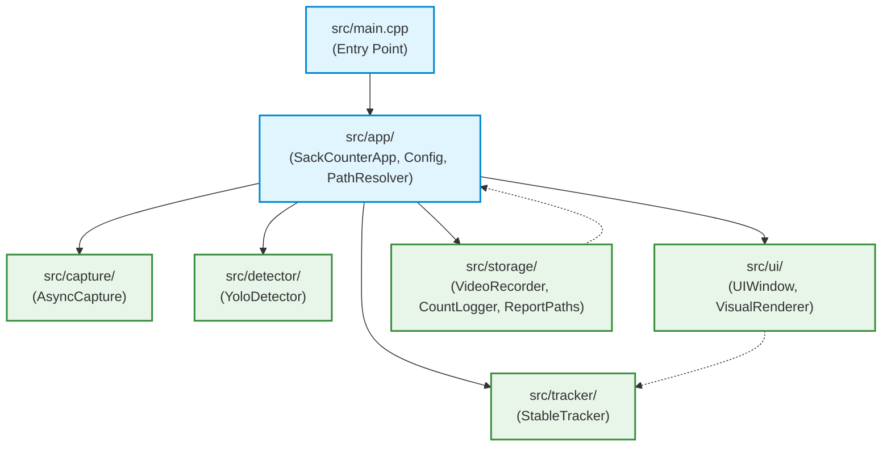

# Rencana Implementasi: Restrukturisasi Direktori Subfolder di dalam `src/`

Dokumen ini merupakan panduan spesifikasi dan rencana kerja teknis (*Folder Hierarchy Refactoring Ticket*) yang disusun secara terperinci agar mudah dieksekusi oleh **Junior Programmer** atau **AI Model (tier standar/hemat)**. Tujuannya adalah mengelompokkan file-file di dalam direktori `src/` ke dalam subfolder berbasis domain fungsional (*Package by Feature / Layered Architecture*) agar arsitektur kode lebih rapi, terisolasi, dan mudah dipelihara.

---

## 1. Latar Belakang & Masalah Saat Ini

Meskipun kode telah dipecah menjadi modul-modul independen (Pipeline & Facade Pattern), saat ini seluruh file header (`.hpp`) dan implementasi (`.cpp`) masih berada di satu tingkat direktori yang sama (*flat structure*) di dalam `src/`:
- Terdapat 12 file `.hpp` dan 12 file `.cpp` yang bercampur baur di `src/`.
- Developer baru atau junior programmer kesulitan membedakan mana file yang berhubungan dengan *UI*, *Storage/Logging*, *AI Detector*, *Tracking Logic*, atau *Core Application*.
- Mengelompokkan file ke dalam subfolder fungsional akan memperjelas batas-batas modul (*modular boundaries*) dan mencegah ketergantungan silang (*circular dependencies*).

---

## 2. Rancangan Struktur Direktori Subfolder Baru

Berikut adalah rancangan pembagian subfolder yang bersih dan modular:

```text
src/
├── app/                        # 1. Core Aplikasi & Konfigurasi
│   ├── app_config.hpp / .cpp
│   ├── path_resolver.hpp / .cpp
│   └── sack_counter_app.hpp / .cpp
│
├── capture/                    # 2. Pengambilan Stream Video / RTSP
│   └── async_capture.hpp / .cpp
│
├── detector/                   # 3. Inferensi YOLO & ONNX Runtime DirectML
│   └── yolo_detector.hpp / .cpp
│
├── tracker/                    # 4. Multi-Object Tracking & Logika Hitung Sak
│   └── stable_tracker.hpp / .cpp
│
├── ui/                         # 5. GUI HighGUI & Rendering Visual
│   ├── ui_window.hpp / .cpp
│   └── visual_renderer.hpp / .cpp
│
├── storage/                    # 6. Perekaman MP4 & Pelaporan Teks Jam
│   ├── count_logger.hpp / .cpp
│   ├── report_paths.hpp / .cpp
│   └── video_recorder.hpp / .cpp
│
└── main.cpp                    # Entry Point Utama Aplikasi
```

---

## 3. Diagram Arsitektur & Dependensi Antar Folder



---

## 4. Rincian Tahapan Implementasi & Estimasi Waktu

Total Estimasi Waktu: **4 - 6 Jam Kerja**

| Tahap | Fokus Pekerjaan | Aksi Teknis | Estimasi Waktu |
| :--- | :--- | :--- | :--- |
| **Tahap 1** | Pembuatan Direktori Subfolder | Buat folder `app/`, `capture/`, `detector/`, `tracker/`, `ui/`, `storage/` | 30 Menit |
| **Tahap 2** | Pemindahan File (*File Relocation*) | Pindahkan file `.hpp` & `.cpp` ke subfolder masing-masing via `git mv` | 1 Jam |
| **Tahap 3** | Pembaruan Path `#include` | Sesuaikan path include di source code (`#include "folder/file.hpp"`) | 1 - 2 Jam |
| **Tahap 4** | Pembaruan `CMakeLists.txt` & Tests | Update path source file di CMake dan include test | 1 Jam |
| **Tahap 5** | Kompilasi & Verifikasi Unit Test | Eksekusi `build.ps1` dan `run_benchmark.ps1` (Zero Regression) | 1 Jam |

---

### Tahap 1: Pembuatan Direktori Subfolder
- **Langkah Kerja:**
  Buat 6 subfolder di dalam direktori `src/`:
  - `src/app/`
  - `src/capture/`
  - `src/detector/`
  - `src/tracker/`
  - `src/ui/`
  - `src/storage/`

---

### Tahap 2: Pemindahan File (*File Relocation*)
Gunakan perintah pemindahan Git (`git mv`) agar riwayat commit (*commit history*) tetap terjaga:
```powershell
git mv src/app_config.* src/app/
git mv src/path_resolver.* src/app/
git mv src/sack_counter_app.* src/app/

git mv src/async_capture.* src/capture/

git mv src/yolo_detector.* src/detector/

git mv src/stable_tracker.* src/tracker/

git mv src/ui_window.* src/ui/
git mv src/visual_renderer.* src/ui/

git mv src/count_logger.* src/storage/
git mv src/report_paths.* src/storage/
git mv src/video_recorder.* src/storage/
```
File [`src/main.cpp`](file:///C:/dev/cpp_rtsp/src/main.cpp) tetap berada di root direktori `src/`.

---

### Tahap 3: Pembaruan Path `#include`
- **Konvensi Header:** Gunakan direktori `src/` sebagai root include (`target_include_directories(sack_core PUBLIC src)`), sehingga include ditulis secara eksplisit dan mudah dilacak:
  - Di `src/main.cpp`:
    ```cpp
    #include "app/app_config.hpp"
    #include "app/sack_counter_app.hpp"
    ```
  - Di `src/app/sack_counter_app.cpp`:
    ```cpp
    #include "app/sack_counter_app.hpp"
    #include "app/path_resolver.hpp"
    #include "capture/async_capture.hpp"
    #include "detector/yolo_detector.hpp"
    #include "storage/count_logger.hpp"
    #include "storage/video_recorder.hpp"
    #include "tracker/stable_tracker.hpp"
    #include "ui/ui_window.hpp"
    #include "ui/visual_renderer.hpp"
    ```
  - Di `src/ui/visual_renderer.hpp`:
    ```cpp
    #include "tracker/stable_tracker.hpp"
    ```
  - Di `src/storage/count_logger.cpp`:
    ```cpp
    #include "storage/count_logger.hpp"
    #include "storage/report_paths.hpp"
    ```
  - Di `tests/stable_tracker_test.cpp`:
    ```cpp
    #include "storage/report_paths.hpp"
    #include "tracker/stable_tracker.hpp"
    ```

---

### Tahap 4: Pembaruan `CMakeLists.txt`
Perbarui daftar file source target `sack_core` di [`CMakeLists.txt`](file:///C:/dev/cpp_rtsp/CMakeLists.txt):
```cmake
add_library(sack_core
    src/app/app_config.cpp
    src/app/path_resolver.cpp
    src/app/sack_counter_app.cpp
    src/capture/async_capture.cpp
    src/detector/yolo_detector.cpp
    src/storage/count_logger.cpp
    src/storage/report_paths.cpp
    src/storage/video_recorder.cpp
    src/tracker/stable_tracker.cpp
    src/ui/ui_window.cpp
    src/ui/visual_renderer.cpp
)

target_include_directories(sack_core PUBLIC
    src
    "${ONNXRUNTIME_INCLUDE_DIR}"
    "${DIRECTML_INCLUDE_DIR}"
)
```

---

### Tahap 5: Kompilasi, Regression Testing, dan Verifikasi
1. Jalankan script build bawaan:
   ```powershell
   .\build.ps1
   ```
2. Jalankan benchmark testing:
   ```powershell
   .\tests\run_benchmark.ps1
   ```
3. Pastikan 100% tes unit lulus tanpa kendala dan file `sack_rtsp.exe` terkompilasi sempurna.

---

## 5. Kriteria Penerimaan (Acceptance Criteria)

- [x] File-file di dalam `src/` telah terdistribusi ke dalam 6 subfolder terpisah (`app`, `capture`, `detector`, `tracker`, `ui`, `storage`).
- [x] Root direktori `src/` hanya berisi `main.cpp` dan folder-folder modul.
- [x] Seluruh `#include` menggunakan path terstruktur (`#include "folder/file.hpp"`).
- [x] Proyek berhasil dikompilasi dengan sukses melalui `build.ps1` tanpa error path include.
- [x] Unit test `stable_tracker_test` dan benchmark suite `run_benchmark.ps1` lulus 100% (*Zero Regression*).
- [x] Riwayat perubahan file dilacak menggunakan Git (`git mv`).
