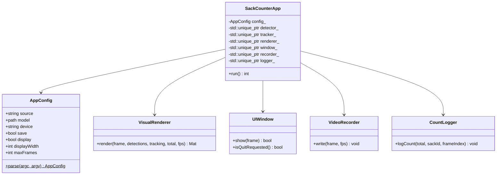
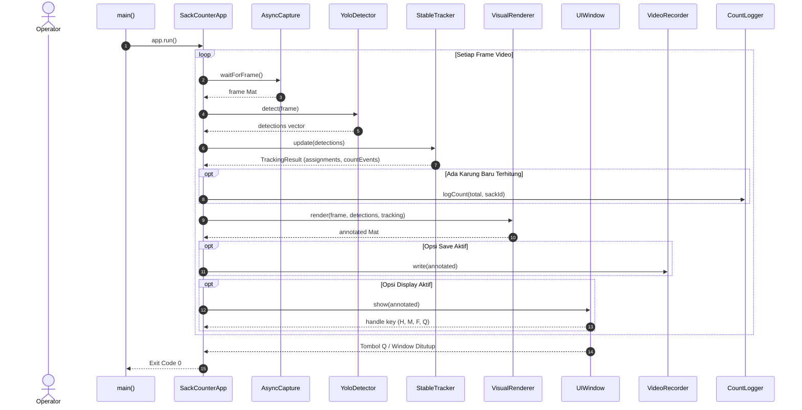

# Rencana Implementasi: Modularisasi File per Fungsi & Penerapan Pipeline-Facade Pattern

Dokumen ini merupakan panduan spesifikasi arsitektur teknis dan rencana implementasi (*Refactoring & Architectural Ticket*) yang dirancang khusus agar mudah dipahami dan dieksekusi oleh **Junior Programmer** atau **AI Model (tier standar/hemat)**. Tujuannya adalah memecah file monolitis `src/main.cpp` menjadi modul-modul independen berdasarkan tanggung jawabnya (*Single Responsibility Principle*) menggunakan **Pipeline & Facade Design Pattern** yang sederhana dan intuitif.

---

## 1. Latar Belakang & Masalah Saat Ini

Saat ini, file [`src/main.cpp`](file:///C:/dev/cpp_rtsp/src/main.cpp) memiliki ukuran lebih dari 600 baris dan menjadi sebuah *"God File"* (file serba tahu) yang menggabungkan terlalu banyak fungsi berbeda:
1. **Parsing Argumen CLI & Environment Variables** (`parseArguments`, `printUsage`).
2. **Pencarian Path Dinamis** (`getExecutablePath`, `findProjectRoot`, `resolveModelPath`).
3. **Logika UI & Window Management** (`fitFrameToWindow`, `cv::namedWindow`, penanganan shortcut tombol `h`, `m`, `f`, `q`, Win32 API).
4. **Rendering & Anotasi Visual** (menggambar checkpoint line, teks total sak, label box beraneka warna, status LOW conf).
5. **Pencatatan Video Rekaman** (inisialisasi `cv::VideoWriter` dan penulisan frame).
6. **Pencatatan Laporan Jam** (`appendCount`, formatting waktu).
7. **Orchestrator Loop Utama** (koordinasi capture $\rightarrow$ inferensi $\rightarrow$ tracking $\rightarrow$ render $\rightarrow$ save).

**Dampaknya:**
- Kode sulit dibaca dan dipelajari oleh programmer junior.
- Perubahan pada satu fitur (misalnya tampilan UI) berisiko merusak logika lain (misalnya penulisan report atau FPS).
- Sulit dibuatkan unit test modular untuk masing-masing fungsi.

---

## 2. Pilihan Design Pattern: Pipeline & Facade Pattern

Untuk menjaga kesederhanaan tanpa *over-engineering*, dipilih kombinasi 2 pola desain yang paling mudah dipahami:

1. **Pipeline Pattern (Pola Aliran Pipa):**
   - Setiap frame video mengalir melalui jalur pemrosesan data satu arah yang jelas dan berurutan:
     $$\text{Frame Masuk} \rightarrow \text{YOLO Detect} \rightarrow \text{Stable Tracker} \rightarrow \text{Visual Renderer} \rightarrow \text{UI Display / Recorder / Logger}$$
2. **Facade Pattern (Pola Pengendali Sederhana - `SackCounterApp`):**
   - Menyediakan satu kelas antarmuka utama (`SackCounterApp`) yang mengkoordinasikan semua modul.
   - File `main.cpp` menjadi sangat ramping (< 35 baris kode) yang hanya bertugas menginisialisasi konfigurasi dan memanggil `app.run()`.

---

## 3. Struktur Modul & Pemisahan File Baru

Struktur direktori `src/` yang baru akan dibagi rapi per fungsi:

```text
src/
├── app_config.hpp / .cpp         # Tanggung Jawab 1: Parsing CLI, argumen --source, options
├── path_resolver.hpp / .cpp      # Tanggung Jawab 2: Resolusi dinamis model & project root
├── visual_renderer.hpp / .cpp    # Tanggung Jawab 3: Gambar garis, bounding box, label teks
├── ui_window.hpp / .cpp          # Tanggung Jawab 4: Window HighGUI, resize, shortcut H/M/F/Q
├── video_recorder.hpp / .cpp     # Tanggung Jawab 5: Penulisan file video MP4
├── count_logger.hpp / .cpp       # Tanggung Jawab 6: Pencatatan file teks laporan per jam
├── sack_counter_app.hpp / .cpp   # Facade: Menjalankan pipeline loop utama
├── async_capture.hpp / .cpp      # (Tetap) Threaded RTSP frame capture
├── yolo_detector.hpp / .cpp      # (Tetap) Inferensi ONNX Runtime DirectML
├── stable_tracker.hpp / .cpp     # (Tetap) Pelacakan & validasi hitung karung
├── report_paths.hpp / .cpp       # (Tetap) Path generator laporan
└── main.cpp                      # Entry point bersih (< 35 baris)
```

---

## 4. Diagram Arsitektur & Alur Eksekusi

### A. Class Diagram (Facade & Components)



### B. Sequence Diagram (Pipeline Pemrosesan Frame)



---

## 5. Rincian Tahapan Implementasi & Estimasi Waktu

Total Estimasi Waktu: **10 - 12 Jam Kerja**

| Tahap | Fokus Pekerjaan | Modul Baru | Estimasi Waktu |
| :--- | :--- | :--- | :--- |
| **Tahap 1** | Ekstraksi Konfigurasi & Resolusi Path | `app_config`, `path_resolver` | 2 Jam |
| **Tahap 2** | Ekstraksi Rendering Visual & UI Window Manager | `visual_renderer`, `ui_window` | 3 Jam |
| **Tahap 3** | Ekstraksi Perekam Video & Logger Laporan | `video_recorder`, `count_logger` | 2 Jam |
| **Tahap 4** | Implementasi Facade `SackCounterApp` & Pembersihan `main.cpp` | `sack_counter_app`, `main.cpp` | 2 Jam |
| **Tahap 5** | Pembaruan `CMakeLists.txt` & Regression Testing | `CMakeLists.txt`, `build.ps1` | 1 - 2 Jam |

---

### Tahap 1: Ekstraksi Konfigurasi & Resolusi Path
- **Tujuan:** Memindahkan struct opsi dan fungsi pencarian file ke modul khusus.
- **Langkah Kerja:**
  1. Buat [`src/app_config.hpp`](file:///C:/dev/cpp_rtsp/src/app_config.hpp) dan `src/app_config.cpp`:
     - Memindahkan `struct AppConfig` (sebelumnya `Options`).
     - Memindahkan fungsi `parseArguments()` dan `printUsage()`.
  2. Buat [`src/path_resolver.hpp`](file:///C:/dev/cpp_rtsp/src/path_resolver.hpp) dan `src/path_resolver.cpp`:
     - Memindahkan `getExecutablePath()`, `findProjectRoot()`, dan `resolveModelPath()`.

---

### Tahap 2: Ekstraksi Rendering Visual & UI Window Manager
- **Tujuan:** Memisahkan antara "menggambar ke gambar" dan "menampilkan jendela GUI".
- **Langkah Kerja:**
  1. Buat [`src/visual_renderer.hpp`](file:///C:/dev/cpp_rtsp/src/visual_renderer.hpp) dan `src/visual_renderer.cpp`:
     - Memindahkan `drawLabel()`, garis checkpoint, bounding box (normal & LOW conf), dan teks overlay total sak/FPS.
  2. Buat [`src/ui_window.hpp`](file:///C:/dev/cpp_rtsp/src/ui_window.hpp) dan `src/ui_window.cpp`:
     - Memindahkan `fitFrameToWindow()`.
     - Mengelola pembuatan window `cv::namedWindow` resizable.
     - Mengelola shortcut keyboard (`Q`, `H` toggle hide, `M` minimize, `F` fullscreen).

---

### Tahap 3: Ekstraksi Perekam Video & Logger Laporan
- **Tujuan:** Isolasi IO penyimpanan ke file terpisah.
- **Langkah Kerja:**
  1. Buat [`src/video_recorder.hpp`](file:///C:/dev/cpp_rtsp/src/video_recorder.hpp) dan `src/video_recorder.cpp`:
     - Membungkus `cv::VideoWriter` dengan metode `open()` dan `write(frame)`.
  2. Buat [`src/count_logger.hpp`](file:///C:/dev/cpp_rtsp/src/count_logger.hpp) dan `src/count_logger.cpp`:
     - Memindahkan fungsi `appendCount()`, rotasi file per jam, dan formatting timestamp.

---

### Tahap 4: Implementasi Facade `SackCounterApp` & Pembersihan `main.cpp`
- **Tujuan:** Menggabungkan seluruh komponen ke dalam satu controller bersih.
- **Langkah Kerja:**
  1. Buat [`src/sack_counter_app.hpp`](file:///C:/dev/cpp_rtsp/src/sack_counter_app.hpp) dan `src/sack_counter_app.cpp`:
     - Menginisialisasi komponen berdasarkan `AppConfig`.
     - Menjalankan loop utama pemrosesan frame.
  2. Ubah [`src/main.cpp`](file:///C:/dev/cpp_rtsp/src/main.cpp) menjadi ramping:
     ```cpp
     #include "app_config.hpp"
     #include "sack_counter_app.hpp"
     #include <iostream>

     int main(int argc, char** argv) {
         try {
             const AppConfig config = AppConfig::parse(argc, argv);
             SackCounterApp app(config);
             return app.run();
         } catch (const std::exception& error) {
             std::cerr << "ERROR: " << error.what() << '\n';
             AppConfig::printUsage();
             return 1;
         }
     }
     ```

---

### Tahap 5: Pembaruan `CMakeLists.txt` & Regression Testing
- **Langkah Kerja:**
  1. Perbarui daftar file source di [`CMakeLists.txt`](file:///C:/dev/cpp_rtsp/CMakeLists.txt):
     ```cmake
     add_library(sack_core
         src/app_config.cpp
         src/async_capture.cpp
         src/count_logger.cpp
         src/path_resolver.cpp
         src/report_paths.cpp
         src/sack_counter_app.cpp
         src/stable_tracker.cpp
         src/ui_window.cpp
         src/video_recorder.cpp
         src/visual_renderer.cpp
         src/yolo_detector.cpp
     )
     ```
  2. Jalankan build dan test:
     ```powershell
     .\build.ps1
     .\tests\run_benchmark.ps1
     ```
  3. Pastikan semua fitur lama tetap berfungsi 100% tanpa regresi.

---

## 6. Kriteria Penerimaan (Acceptance Criteria)

- [x] File `src/main.cpp` berukuran kurang dari 50 baris kode (saat ini 16 baris) dan hanya berisi *entry point*.
- [x] Setiap fungsi terpisah ke dalam modul header (`.hpp`) dan implementasi (`.cpp`) masing-masing.
- [x] Arsitektur mengimplementasikan pola **Pipeline** dan **Facade (`SackCounterApp`)** dengan jelas.
- [x] Seluruh fitur fungsional lama tetap berjalan normal:
  - Deteksi model dinamis (`path_resolver`).
  - Window resizable tanpa scrollbar (`ui_window`).
  - Shortcut keyboard `H` (hide), `M` (minimize), `F` (fullscreen), `Q` (quit).
  - Tampilan bounding box confidence rendah `[LOW]`.
  - Penyimpanan video MP4 & log file per jam.
- [x] Proyek berhasil dikompilasi tanpa error (`build.ps1`) dan unit test lulus 100%.
